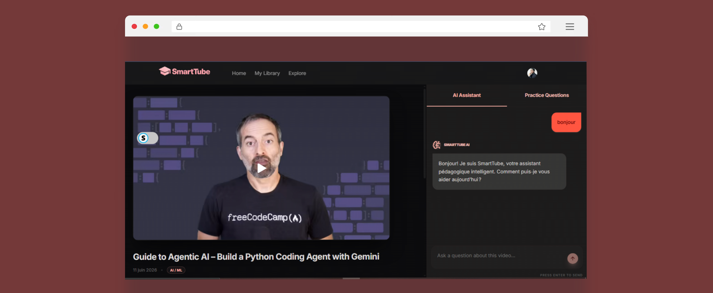

# 🎬 SmartTube — Monorepo (Next.js 16 & FastAPI)

<div align="center">


**Transformez n'importe quelle vidéo YouTube en espace d'apprentissage interactif.**  
Notes synthétiques intelligentes, quiz interactifs de révision et chat IA sémantique avec navigation par horodatage.

[Démonstration](#-démonstration-vidéo) • [Fonctionnalités](#-fonctionnalités) • [Architecture](#-architecture) • [Démarrage Rapide](#-démarrage-rapide) • [Variables d'Environnement](#-variables-denvironnement) • [Déploiement](#-guide-de-déploiement-production)

</div>

---

## 🎥 Démonstration Vidéo

<div align="center">
  <video src="front/public/smarttube.mp4" width="100%" poster="front/public/img.png" controls autoplay loop muted playsinline style="border-radius: 12px; box-shadow: 0 10px 30px rgba(0,0,0,0.3);">
    <a href="front/public/smarttube.mp4">
      
    </a>
  </video>
  <p align="center">
    <sub><em>▶️ Aperçu vidéo de l'expérience utilisateur SmartTube (lecteur interactif, notes générées, quiz et chat RAG).</em></sub>
  </p>
</div>

---

## ✨ Fonctionnalités

- 🎯 **Extraction & Transcription Automatique** : Récupération instantanée des transcripts de vidéos YouTube via `youtubei.js` et service de fallback `Supadata`.
- 🧠 **RAG Hybride Avancé (Retrieval-Augmented Generation)** :
  - Recherche hybride combinant la sémantique vectorielle dense (modèle `openai/text-embedding-3-small` en 1536 dimensions) et mots-clés BM25 sur **Pinecone Serverless**.
  - Reranking intelligent via **Cohere Rerank** (`cohere/rerank-4-fast`) pour garantir des sources ultra-précises dans le contexte du LLM.
- 📝 **Fiches de Révision Structurées** : Synthèse par sections claires avec définitions clés, formules et concepts essentiels.
- ❓ **Quiz Interactifs & Scoring** : Évaluation immédiate de la compréhension avec explications détaillées et suivi du score.
- 💬 **Chat Vidéo avec Timestamps Cliquables** : Posez n'importe quelle question sur la vidéo ; l'IA cite directement les passages avec des liens interactifs qui positionnent le lecteur au moment exact.
- 🌐 **Internationalisation (i18n)** : Support complet multilingue Français / Anglais avec détection automatique de la langue.
- 🌓 **Mode Sombre & Clair** : Thème soigné et adaptatif propulsé par Tailwind CSS et Shadcn UI.
- 🐳 **Dockerisé** : Backend prêt pour la production avec Docker multi-stage et healthcheck automatisé.

---

## 🏗️ Architecture du Projet

Le projet est structuré sous forme de monorepo découplé :

```text
smarttube/
├── back/                    # 🐍 Backend FastAPI & Pipeline IA
│   ├── app/
│   │   ├── api/routes/      # Endpoints REST (/api/chat, /api/videos, /api/study)
│   │   ├── config/          # Pydantic Settings & validation des configs
│   │   ├── models/          # Modèles SQLAlchemy (User, Video, Segment, Quiz)
│   │   └── services/        # Services RAG, Pinecone, LLM, Embeddings & Reranker
│   ├── Dockerfile           # Image Docker optimisée pour la production
│   ├── docker-compose.yml   # Lancement local immédiat du backend
│   ├── pyproject.toml       # Spécification moderne des dépendances Python
│   ├── requirements.txt     # Dépendances pip pour Docker et cloud providers
│   └── .env.example         # Template commenté pour le backend
│
├── front/                   # ⚡ Frontend Next.js 16 (Turbopack, App Router)
│   ├── public/              # Vidéo démo optimisée (smarttube.mp4), logos et médias
│   ├── src/
│   │   ├── app/[locale]/    # Routes localisées Next-Intl (/, /study, /library)
│   │   ├── components/      # Composants UI React 19 (Player, Chat, Quiz, Thème)
│   │   ├── i18n/            # Configuration de routage et détection des langues
│   │   └── messages/        # Dictionnaires de traduction (fr.json, en.json)
│   ├── package.json         # Scripts et dépendances frontend
│   └── .env.example         # Template commenté pour le frontend
│
├── .env.example             # Guide global des variables d'environnement
├── .gitignore               # Protection stricte contre les fuites de secrets/médias lourds
└── README.md                # Documentation complète
```

---

## 🚀 Démarrage Rapide

### Prérequis
- [Node.js](https://nodejs.org) (v20+)
- [Python](https://python.org) (v3.12+) ou [Docker](https://www.docker.com)
- Une base de données PostgreSQL en ligne ([Neon Cloud](https://neon.tech) recommandé)
- Clés d'API : [Clerk](https://clerk.com), [Pinecone](https://www.pinecone.io) et [Google AI Studio](https://aistudio.google.com/) ou [OpenRouter](https://openrouter.ai/)

---

### 1. Cloner le Dépôt

```bash
git clone https://github.com/<votre-compte>/smarttube-nextjs-fastapi.git
cd smarttube-nextjs-fastapi
```

---

### 2. Démarrer le Backend (`back`)

> [!TIP]
> **🐳 Utilisation de Docker pour le Backend (Recommandé)** :  
> Vous **n'avez pas besoin d'installer Python 3.12** ni de configurer d'environnement virtuel (`venv`) sur votre machine !  
> Le dossier `back/` contient déjà un `Dockerfile` et un `docker-compose.yml` préconfigurés. Tout s'exécute dans un conteneur isolé avec toutes les dépendances compilées.

#### Option A : Avec Docker (Le plus simple & sans installer Python)

1. Rendez-vous dans le dossier `back` et configurez votre `.env` :
   ```bash
   cd back
   cp .env.example .env
   # Renseignez vos clés dans back/.env
   ```

2. Lancez le backend avec Docker Compose :
   ```bash
   docker compose up -d
   ```
   *L'API est immédiatement accessible sur `http://localhost:8000`.*

3. **Commandes Docker utiles pour le backend :**
   ```bash
   # Consulter les logs en temps réel
   docker compose logs -f

   # Reconstruire l'image après une modification de code
   docker compose up --build -d

   # Arrêter le backend
   docker compose down
   ```

#### Option B : Avec Python en local (sans Docker)

Si vous préférez exécuter Python directement sur votre machine hôte :

```bash
cd back
python3 -m venv .venv
source .venv/bin/activate       # Sur Windows : .venv\Scripts\activate

pip install -r requirements.txt
cp .env.example .env
# Remplissez vos clés dans back/.env

uvicorn app.main:app --reload --port 8000
```

Documentation interactive de l'API : **`http://localhost:8000/api/docs`**  
Vérification de santé : **`http://localhost:8000/health`**

---

### 3. Démarrer le Frontend (`front`)

Dans un second terminal :

```bash
cd front
npm install
cp .env.example .env.local
# Remplissez vos clés Clerk et l'URL backend dans front/.env.local

npm run dev
```

L'application est accessible sur **`http://localhost:3000`**.

---

## 🔑 Variables d'Environnement

Des fichiers `.env.example` détaillés et commentés sont disponibles :
- **Vue globale :** [`.env.example`](./.env.example)
- **Backend :** [`back/.env.example`](./back/.env.example)
- **Frontend :** [`front/.env.example`](./front/.env.example)

### Résumé des variables indispensables

| Service | Variable | Localisation | Description |
| :--- | :--- | :--- | :--- |
| **PostgreSQL** | `DATABASE_URL` | `back/.env` | URL de connexion (ex: Neon avec `sslmode=require`) |
| **LLM & IA** | `AI_KEY` | `back/.env` | Clé Google Gemini ou OpenRouter |
| **Pinecone** | `PINECONE_API_KEY` | `back/.env` | Clé API Pinecone Serverless |
| **Pinecone** | `PINECONE_INDEX` | `back/.env` | Nom de l'index (défaut : `smarttubes`, dim: 1536) |
| **Clerk (Back)**| `CLERK_SECRET_KEY` | `back/.env` | Clé secrète Clerk pour valider les tokens |
| **Clerk (Front)**| `NEXT_PUBLIC_CLERK_PUBLISHABLE_KEY` | `front/.env.local` | Clé publique Clerk pour l'UI d'authentification |
| **Clerk (Front)**| `CLERK_SECRET_KEY` | `front/.env.local` | Clé secrète Clerk pour le Server-Side Next.js |
| **API Client** | `NEXT_PUBLIC_API_URL` | `front/.env.local` | `http://localhost:8000/api` (dev) ou URL Cloud |

---

## 🌐 Guide de Déploiement Production

Le projet utilise l'architecture découplée recommandée : **Backend Dockerisé** sur [Render](https://render.com) (ou Railway) + **Frontend Serverless** sur [Vercel](https://vercel.com).

### 1. Déploiement du Backend sur Render (Docker)
1. Créer un **New Web Service** connecté à votre repo GitHub.
2. Définir le **Root Directory** sur `back`.
3. Sélectionner l'environnement **Docker** (il détectera automatiquement le `back/Dockerfile`).
4. Dans **Environment Variables**, ajouter toutes les variables de `back/.env`.
5. Renseigner `CORS_ORIGINS=["https://votre-domaine-vercel.app"]`.
6. Valider : tester l'endpoint `/health` (ex: `https://smarttube-api.onrender.com/health`).

### 2. Déploiement du Frontend sur Vercel
1. Importer le repo sur Vercel.
2. Définir le **Root Directory** sur `front`.
3. Configurer les variables d'environnement :
   - `NEXT_PUBLIC_API_URL=https://smarttube-api.onrender.com/api`
   - `NEXT_PUBLIC_CLERK_PUBLISHABLE_KEY`
   - `CLERK_SECRET_KEY`
4. Déployer.

### 3. Configuration Clerk
- Dans le tableau de bord Clerk, autoriser le domaine de production Vercel dans **Configure > Domains / Paths**.

---

## 🛡️ Sécurité & Bonnes Pratiques

- **Protection des identifiants :** Le fichier `.gitignore` bloque systématiquement les fichiers `.env`, `.env*.local`, ainsi que les médias lourds (> 100 Mo).
- **Contrôle d'accès :** Toutes les routes privées (`/library`, `/study`, `/api/videos`) sont vérifiées côté serveur via Clerk.
- **Requêtes vectorielles étanches :** Isolation des données par utilisateur et par vidéo dans Pinecone via des métadonnées dédiées (`userId`, `videoId`).

---

## 📄 Licence

Ce projet est sous licence MIT. Libre à vous de l'utiliser et de le faire évoluer !
